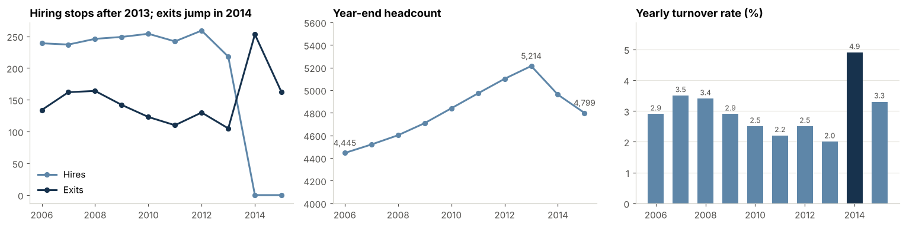
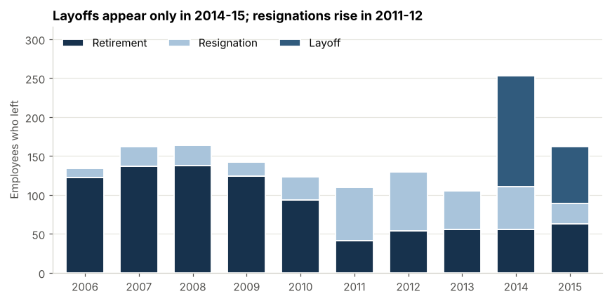
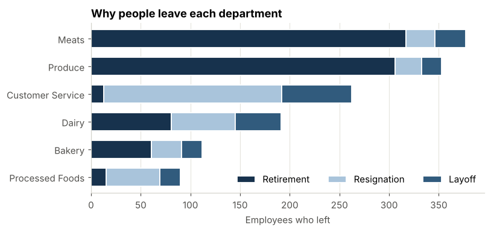
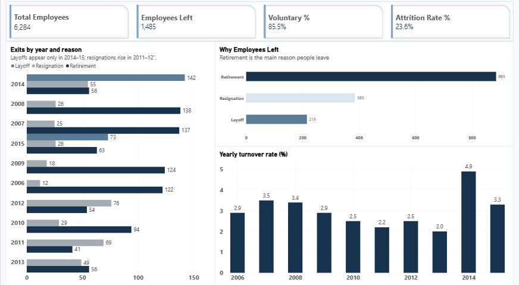
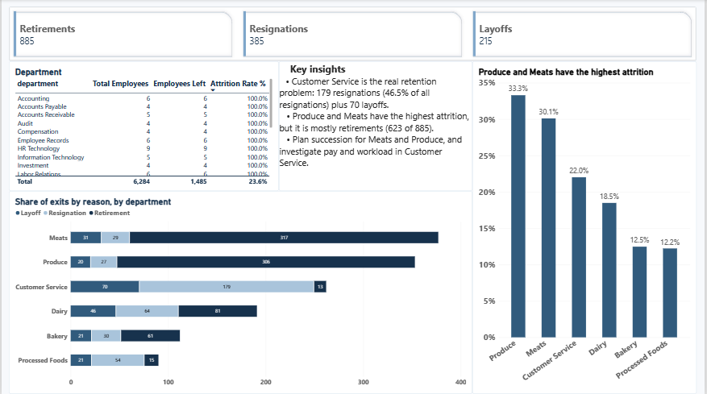
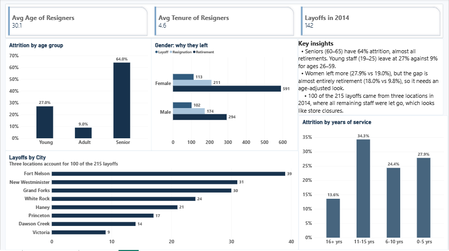

# Employee Attrition Analysis (2006–2015)

***In short***: most exits are retirements, Customer Service is the real retention problem, and the 2014 spike came from layoffs and a hiring stop.

**Business question:** Who leaves the company, when do they leave, and why?

A Python / Pandas analysis and Power BI dashboard of 10 years of HR data from a retail company (stores with Produce, Meats, Dairy, Customer Service and other departments). The raw file has one row per employee per year (49,653 rows); after cleaning it covers **6,284 employees**, of whom **1,485 left**.

## Key findings

| # | Finding |
|---|---|
| 1 | 1,485 of 6,284 employees (23.6%) left in 2006–2015, but the yearly turnover rate is only 2.0–4.9%. The 23.6% is the cumulative share over ten years, not an annual rate. |
| 2 | **Retirement is the biggest reason (59.6%)**, then resignation (25.9%) and layoff (14.5%). 85.5% of exits are voluntary. |
| 3 | **2014 was an outlier year** (4.9% turnover, 253 exits). Layoffs start in 2014 (142, then 73 in 2015) and no hires appear after 2013, so year-end headcount fell 8.0% (5,214 to 4,799). |
| 4 | **100 of the 215 layoffs came from three locations** (Fort Nelson, New Westminster, Grand Forks), where everyone still working in 2014 was let go. This looks like store closures. |
| 5 | **Customer Service has the real retention problem:** 179 resignations (46.5% of all resignations) plus 70 layoffs. |
| 6 | Produce (33.3%) and Meats (30.1%) have the highest attrition, but it is mostly retirements. Together they account for 623 of the company’s 885 retirements (70%). |
| 7 | **Early-career staff leave more:** 27.0% of ages 19–25 (199 of 736) vs 9.0% of ages 26–59 (371 of 4,119). The gap is mostly resignations (22.3% vs 5.3%). Ages are at the employee's last record, and no retirements fall in either group because all retirements happen at 60 or 65. The typical resigner is 29 years old with 4 years of service. |
| 8 | Women left more often than men (27.9% vs 19.0%), but the gap is almost entirely retirement (18.0% vs 9.8%), so it needs an age-adjusted look before any conclusion. |







## Power BI dashboard

Interactive 3-page dashboard built from `Attrition_cleaned.csv` and `yearly_summary.csv`. Open `powerbi/Attrition_Analysis.pbix` in Power BI Desktop.

| Page | What it shows |
|---|---|
| Overview | KPI cards (employees, left, attrition rate, voluntary %), why employees left, exits by year and reason, yearly turnover rate |
| Departments | Attrition rate by department, mix of exit reasons, full department table, reason cards that respond to clicks |
| People | Attrition by age and tenure group, gender split by reason, layoffs by city, resigner profile cards |

**DAX measures:** Total Employees, Employees Left, Attrition Rate %, Voluntary %, Retirements, Resignations, Layoffs, Avg Age of Resigners, Avg Tenure of Resigners, Layoffs in 2014.







## Recommendations

1. Investigate Customer Service retention (pay, workload, career path in the first 5 years).
2. Plan for retirements in Meats and Produce with succession planning.
3. Review the 2014–15 layoff decisions and why no hiring is recorded after 2013.
4. Look into the 2011–12 jump in resignations.

## What I did

1. **Loaded and inspected** the data (`head`, `info`, missing values, duplicates).
2. **Cleaned it:**
   - kept each employee's latest record with `drop_duplicates(subset='EmployeeID', keep='last')`
   - converted dates with `to_datetime`
   - fixed typos and text casing
   - replaced the `1900-01-01` placeholder date with an empty value
   - simplified job titles with `apply`
   - created age and tenure groups with `cut`
   - created a `left` flag (1 = left)
3. **Analysed attrition** by reason, year, department, age, tenure, gender and city, using attrition *rates* (not just counts).
4. **Checked for outliers** with the IQR rule.
5. Wrote the conclusion, recommendations and limitations.
6. Built a 3-page interactive Power BI dashboard (Overview, Departments, People) with DAX measures.

## Limitations

- Data covers 2006–2015 only; people who left before 2006 are not included and no hires appear after 2013.
- Small groups (head-office teams, small cities) give unreliable rates.
- No salary, performance or satisfaction data, so the analysis shows *who* and *when*, not *why* people resign.
- Correlation is not causation.

## SQL analysis

I re-answered the key questions with SQL (SQLite) to check the Python results. All 11 queries are in `sql/attrition_queries.sql`, and every number matches the findings above.

| Question | SQL used |
|---|---|
| How many left, and what share? | `COUNT`, `SUM`, percentages |
| Why do people leave? | `GROUP BY`, `SUM() OVER ()` for share of total |
| Exits per year vs the year before | CTE, `LAG()` |
| Yearly turnover rate | two CTEs, `JOIN` across both tables |
| Highest-attrition departments | `HAVING`, `RANK()` |
| Where resignations come from | running total with `SUM() OVER (ORDER BY ...)` |
| Cities behind the layoffs | `ROW_NUMBER()`, cumulative % |
| Early-career vs other staff | `CASE WHEN`, conditional counts |
| Gender and exit reason | conditional aggregation |
| Typical resigner (mean and median) | `AVG`, median with window functions |

To run them (needs `pandas`):

```
python sql/run_sql.py        # all queries
python sql/run_sql.py 5      # only Q5
```


## Files

| File | Description |
|---|---|
| `Attrition_Analysis.ipynb` | Full notebook with explanations, code and charts |
| `Attrition_dataset.csv` | Original data (49,653 rows, 18 columns) |
| `Attrition_cleaned.csv` | Cleaned data, one row per employee (6,284 rows) |
| `yearly_summary.csv` | Hires, exits, headcount and turnover rate per year |
| `images/` | Charts used in this README |
| `powerbi/` | Power BI file (`Attrition_Analysis.pbix`) and dashboard screenshots |
| `sql/` | 11 SQL queries (SQLite) and a script to run them |


## How to run

```
pip install pandas numpy matplotlib seaborn jupyter
jupyter notebook Attrition_Analysis.ipynb
```

Keep `Attrition_dataset.csv` in the same folder as the notebook.

## Tools

Python, Pandas, NumPy, Matplotlib, Seaborn, Jupyter Notebook, Power BI, DAX, SQL (SQLite)

## Next steps

- logistic regression

## Author

**VARSHINI GANESAN**: [GitHub](https://github.com/vrshy) | [LinkedIn](https://www.linkedin.com/in/varshiganesan)
